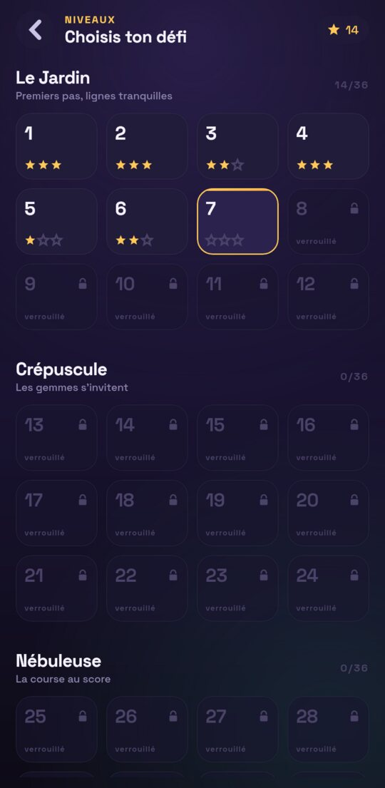
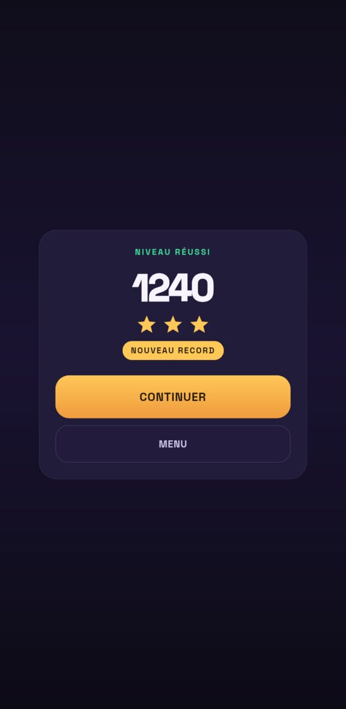

# Blocksmith

**Le puzzle de blocs 8×8, sans publicité, sans compte, hors-ligne.**

<p>
  <a href="https://github.com/joynix28/blocksmith/releases/latest/download/Blocksmith-1.0.0.apk">
    
  </a>
</p>

Un jeu de placement de pièces inspiré des puzzles de blocs classiques : trois
pièces à la fois, des lignes à compléter, des combos à entretenir. Pas de
bannière, pas de monnaie virtuelle, pas de « revive » payant. Le jeu ne demande
même aucune permission Android.

<p align="center">
  
  
  
  
</p>

## Ce qui est dedans

- **Mode classique infini** : plateau 8×8, trois pièces, combos, meilleur score.
- **48 niveaux** en quatre chapitres, avec objectifs variés (lignes, score,
  gemmes, survie) et étoiles selon le nombre de poses.
- **Défi du jour** : même tirage pour tout le monde, calculé à partir de la date.
- **Indice** : un solveur intégré propose le meilleur coup, en tenant compte de
  l'objectif du niveau. Il ne triche pas : il ne connaît que les pièces visibles.
- **Réglages** : sons et vibrations, statistiques, remise à zéro.
- **Hors-ligne complet** : aucune connexion, aucun compte, aucune permission.

## Détails techniques

| | |
|---|---|
| Langage | Kotlin 2.2 |
| Interface | Jetpack Compose / Compose Multiplatform 1.7.3 |
| Android | minSdk 26, targetSdk 35, APK signé de ~1,1 Mo |
| Modules | `shared` (moteur + UI), `app` (Android), `desktop` (runner de dev) |
| Dépendances | Compose uniquement — ni DI, ni réseau, ni base de données |

Le cœur du jeu (`shared/.../game`) est du **Kotlin pur**, sans Android :
plateau immuable, règles, scoring, générateur de pièces, catalogue de niveaux,
solveur. Tout est testé sur JVM.

```
shared/src/commonMain/kotlin/com/botillon/blocksmith/
├── game/
│   ├── Model.kt      plateau, pièces, états, objectifs
│   ├── Shapes.kt     catalogue de formes (rotations incluses)
│   ├── Engine.kt     règles, scoring, combos, générateur équitable
│   ├── Session.kt    une partie = un plateau + un générateur
│   ├── Levels.kt     48 niveaux déterministes, graines calibrées
│   └── Advisor.kt    solveur (indice) + bot de test
└── ui/               thème, écrans, plateau Canvas, drag & drop
```

### Règles et scoring

- 8×8, trois pièces par main, **pas de rotation**.
- Poser une case = 1 point.
- Effacer des lignes : `lignes × 10 × combo + bonus(lignes)`.
  Bonus : 10 / 20 / 60 / 120 / 200 / 300 pour 1 à 6+ lignes.
- Le combo monte à chaque pose qui efface, et retombe après trois poses sans
  effacement.
- Plateau vidé : bonus de 300 × combo.
- La partie s'arrête quand aucune pièce de la main ne peut se poser.

### Un générateur qui ne triche pas

Le tirage est pondéré : les grosses pièces perdent du poids quand le plateau se
remplit, et une main contient toujours **au moins une pièce posable**. Sans
cela, une partie peut se terminer sur un tirage impossible, ce qui est frustrant
et n'apporte aucun plaisir de jeu.

### Équilibrage vérifié par un bot

Les 48 niveaux sont rejoués automatiquement par le solveur dans les tests. Les
graines de pièces et les « par » ont été calibrés pour que chaque niveau soit
gagnable. Le bot sert aussi à vérifier qu'une modification des règles ne casse
pas la courbe de difficulté.

```bash
./gradlew :shared:desktopTest     # moteur + niveaux + non-régression
./gradlew :desktop:tune           # rejoue les 48 niveaux et affiche le détail
./gradlew :desktop:gallery        # rend les écrans en PNG (revue visuelle)
./gradlew :desktop:run            # joue au jeu sur desktop
```

## Compiler l'APK

```bash
./gradlew :app:assembleRelease
# app/build/outputs/apk/release/app-release.apk
```

APK signé de la version 1.0.0 :
[releases/tag/v1.0.0](https://github.com/joynix28/blocksmith/releases/tag/v1.0.0)
(miroir : <https://gofile.io/d/psr7TmPh>).

La signature utilise `keys/blocksmith.jks` (absent du dépôt). Sans ce fichier,
la compilation retombe sur la signature de debug — pratique pour tester, à
remplacer par votre propre clé pour une publication.

## Licence et crédit

Code sous **Apache License 2.0**. La licence impose de conserver la notice
d'attribution : voir [`NOTICE`](NOTICE).

> Si vous réutilisez ce code, son design ou l'idée, **créditez Joynix** et
> renvoyez vers ce dépôt. C'est la seule condition.

Police : [Space Grotesk](https://github.com/floriankarsten/space-grotesk),
SIL Open Font License 1.1. Sons synthétisés pour le projet
(`scripts/gen_sounds.py`).

Projet non affilié à HungryStudio ni à Block Blast. Aucune ressource graphique
ou sonore du jeu d'origine n'est utilisée : l'identité visuelle et les sons sont
originaux.
