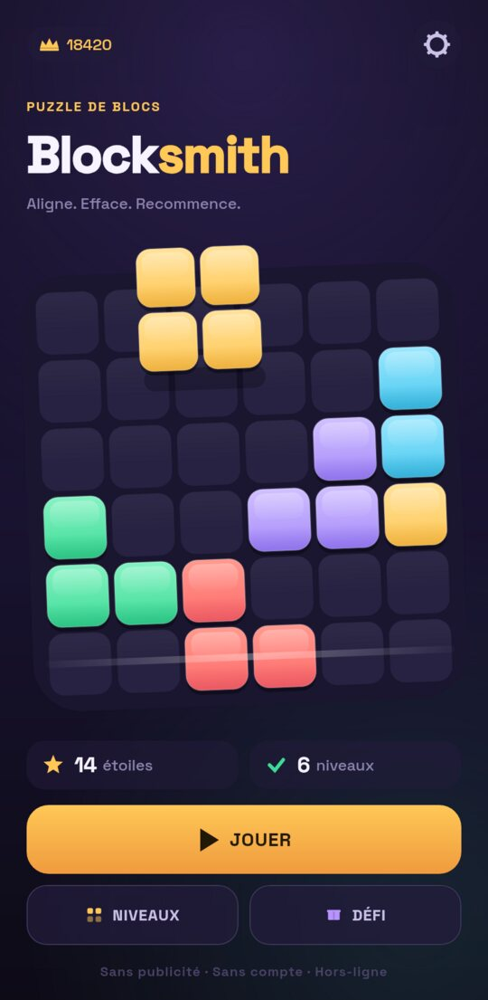
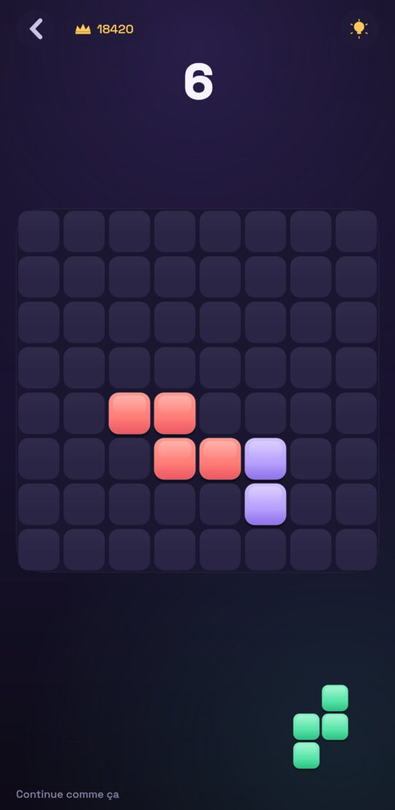

# Blocksmith

**Un puzzle de blocs 8×8, gratuit, sans publicité et entièrement hors-ligne.**

Trois pièces à la fois. On les fait glisser sur le plateau, on complète des
lignes, elles s'effacent, et on recommence. Simple à comprendre, difficile à
lâcher.

<p align="center">
  
  
  
  
</p>

<p align="center">
  <a href="https://github.com/joynix28/blocksmith/releases/latest">
    
  </a>
</p>

## Installer

1. Téléchargez `Blocksmith-1.0.x.apk` depuis les
   [releases](https://github.com/joynix28/blocksmith/releases/latest).
2. Ouvrez le fichier sur votre téléphone.
3. Autorisez l'installation depuis cette source si Android le demande.

Android 8 ou plus récent. L'application ne demande **aucune permission** : pas
d'accès réseau, pas de stockage, pas de localisation. Tout tient dans 1,1 Mo.

## Jouer

- Faites glisser une pièce de la main vers le plateau.
- Une ligne ou une colonne complète s'efface immédiatement.
- Enchaîner les effacements fait monter le **combo**, qui multiplie les points.
  Trois poses sans effacer et le combo retombe.
- La partie s'arrête quand plus aucune pièce de la main ne peut se poser.

Le bouton ampoule donne un **indice gratuit** : le jeu calcule le meilleur coup
visible, en tenant compte de l'objectif du niveau.

### Les modes

| Mode | Ce que c'est |
|---|---|
| **Jouer** | Partie infinie, record sauvegardé sur l'appareil |
| **Niveaux** | 48 niveaux en 4 chapitres, avec objectifs et étoiles |
| **Défi** | Une grille par jour, identique pour tout le monde |

Dans les niveaux, les objectifs varient : effacer un nombre de lignes, marquer
des points, récupérer des gemmes ou simplement tenir un certain nombre de poses.

## Réglages

Sons, vibrations, statistiques et remise à zéro. La progression (record,
étoiles, réglages) est stockée localement, sans compte et sans synchronisation.

## Pourquoi une version sans publicité

Parce qu'un puzzle se joue par petites sessions, souvent hors-ligne, et qu'une
publicité au milieu d'une partie casse exactement ce qui fait revenir : le
calme. Tout le jeu est donc financé par rien, et c'est très bien ainsi.

## Compiler

Prérequis : JDK 17, Android SDK 35.

```bash
./gradlew :app:assembleRelease
# → app/build/outputs/apk/release/app-release.apk
```

Sans fichier de signature (`keys/blocksmith.jks`), le build utilise la clé de
debug : parfait pour tester, à remplacer par la vôtre pour publier.

### Développement

```bash
./gradlew :desktop:run          # jouer sur ordinateur (même code d'interface)
./gradlew :shared:desktopTest   # tests du moteur et des niveaux
./gradlew :desktop:gallery      # générer les captures d'écran
./gradlew :desktop:tune         # rejouer les 48 niveaux avec le bot
```

## Comment c'est fait

| | |
|---|---|
| Langage | Kotlin 2.2 |
| Interface | Jetpack Compose / Compose Multiplatform 1.7.3 |
| Modules | `shared` (moteur + interface), `app` (Android), `desktop` (outil de dev) |
| Dépendances | Compose uniquement |

Le moteur (`shared/src/commonMain/.../game`) est du Kotlin pur, sans Android :
plateau immuable, règles, scoring, générateur de pièces, catalogue de niveaux et
solveur. Il est testé sur JVM, et les 48 niveaux sont rejoués automatiquement
pour vérifier qu'ils restent gagnables.

```
shared/src/commonMain/kotlin/com/botillon/blocksmith/
├── game/   plateau, formes, règles, générateur, niveaux, solveur
└── ui/     thème, accueil, plateau, main, niveaux, réglages
```

### Règles du score

- Poser une case : 1 point.
- Effacer des lignes : `lignes × 10 × combo + bonus`.
  Bonus : 10, 20, 60, 120, 200, 300 pour 1 à 6+ lignes.
- Plateau vidé : bonus de 300 × combo.
- Le combo augmente à chaque pose qui efface, et retombe après trois poses
  sans effacement.

## Licence

Code publié sous **Apache License 2.0**. Voir [`LICENSE`](LICENSE) et
[`NOTICE`](NOTICE).

> **Crédit obligatoire.** Si vous réutilisez ce code, son design ou son idée,
> créditez **Joynix** avec un lien vers ce dépôt. C'est la seule condition.

Police [Space Grotesk](https://github.com/floriankarsten/space-grotesk) (SIL OFL
1.1). Sons synthétisés pour le projet. Projet indépendant, sans lien avec un
éditeur de jeu existant.
